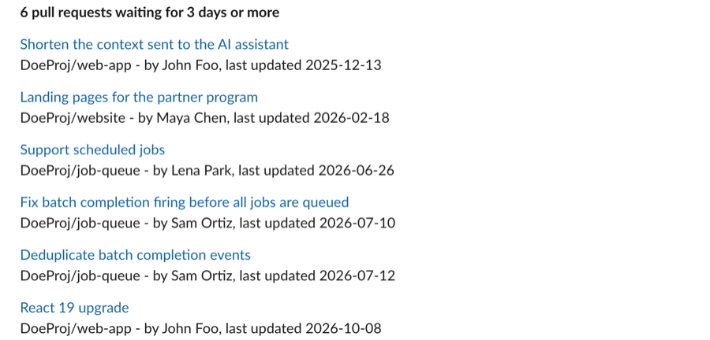

# Stale pull requests in Slack

Every morning, a message in your engineering channel lists the pull requests
nobody has touched for 3 days, each linked to it, so that they get a review
before they go stale for good.



The script asks the Keypup reporting API for the pull requests still open and
not updated for 3 days, bots left out, then posts them with Slack's
`chat.postMessage`. Change `STALE_DAYS` or the filters at the top of
[`stale_pull_requests.rb`](stale_pull_requests.rb) to change what counts as
stale.

## 1. Create the Slack app

1. Open [api.slack.com/apps](https://api.slack.com/apps) and choose
   **Create New App**, then **From an app manifest**.
2. Pick your workspace, paste [`manifest.yml`](manifest.yml) and create the
   app. The manifest gives it two permissions: posting messages
   (`chat:write`), and posting in public channels it has not been invited to
   (`chat:write.public`).
3. In **Install App**, install it to your workspace and allow it.
4. Copy the **Bot User OAuth Token** shown there, which starts with `xoxb-`.

To post in a private channel, invite the app to it first: type
`/invite @Keypup` in the channel.

## 2. Configure

In the `.env` file at the root of this repository (see the
[main README](../README.md)):

```
SLACK_BOT_TOKEN=xoxb-...
SLACK_CHANNEL=#engineering
```

## 3. Run it

```
ruby slack-stale-pull-requests/stale_pull_requests.rb
```

Then schedule it, for example every weekday at 9am with cron:

```
0 9 * * 1-5 cd /path/to/api-examples && ruby slack-stale-pull-requests/stale_pull_requests.rb
```

or with a scheduled GitHub Actions workflow, the tokens stored as the
repository's secrets.
